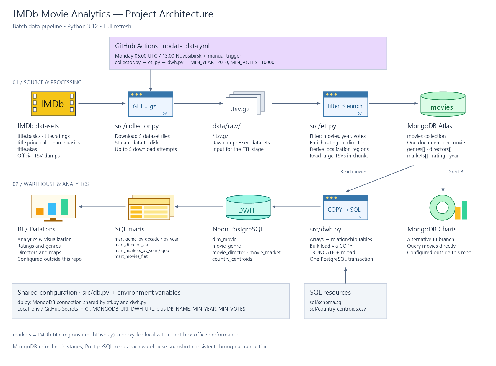

# IMDb Movie Analytics

<p align="center">
  <a href="https://www.imdb.com/">
    
  </a>
</p>

An end-to-end batch pipeline for movie analytics: download the official [IMDb non-commercial datasets](https://datasets.imdbws.com/), build an enriched movie collection in MongoDB Atlas, and load a relational warehouse in Neon PostgreSQL. SQL marts support analysis of genre trends, ratings, directors, and localization markets in BI tools such as DataLens. MongoDB Charts can also use the MongoDB collection directly.

## Architecture

MongoDB Atlas serves as the pipeline's **OLTP database**, storing movie documents and providing the source data for the warehouse. Neon PostgreSQL serves as the **OLAP data warehouse**, exposing relational tables and SQL marts for BI analytics. The current pipeline refreshes MongoDB in batches rather than through live application transactions.



[Edit the diagram in Excalidraw](docs/IMDb-Project-architecture.excalidraw).

1. **Extract — `src/collector.py`:** downloads `title.basics`, `title.ratings`, `title.principals`, `name.basics`, and `title.akas` into `data/raw/`. Downloads stream to disk and retry up to five times on failure.
2. **Transform and load — `src/etl.py`:** selects `movie` titles by minimum release year and vote count, joins ratings, resolves director names, derives localization markets, and reloads the MongoDB `movies` collection. The large principals and regional-title files are processed in chunks.
3. **Warehouse load — `src/dwh.py`:** reads the MongoDB collection, flattens array attributes into related tables, applies the SQL schema, and loads PostgreSQL through `COPY`. Tables and country reference data are refreshed in one transaction.
4. **Analytics:** PostgreSQL views expose ready-to-query marts for BI; MongoDB Charts can query `movies` independently.

## Setup and usage

Use Python 3.12, matching the GitHub Actions workflow, a MongoDB database, and a Neon PostgreSQL database. Run commands from the repository root:

```bash
python -m venv .venv
# Activate: source .venv/bin/activate (macOS/Linux)
# Activate: .venv\Scripts\Activate.ps1 (PowerShell)
python -m pip install -r requirements.txt
```

Copy `.env.example` to `.env` (`cp .env.example .env` in Bash or `Copy-Item .env.example .env` in PowerShell). Fill in your MongoDB connection string and add `DWH_URL`, which is required by the warehouse stage:

```dotenv
MONGODB_URI=mongodb+srv://<user>:<password>@<cluster>/?appName=IMDb
DB_NAME=imdb
MIN_YEAR=2010
MIN_VOTES=10000
DWH_URL=postgresql://<user>:<password>@<neon-host>/<database>?sslmode=require
```

The PostgreSQL user must be able to create tables, views, and indexes, reload tables, and recreate the country reference table and geographic view. The loader applies `sql/schema.sql` automatically.

Run the pipeline in order:

```bash
python src/collector.py
python src/etl.py
python src/dwh.py
```

The collector downloads all five dumps on every run. Allow sufficient disk space and memory: only the principals and regional-title files are read in chunks; other source files and the warehouse export are loaded into memory.

To reload PostgreSQL from the existing MongoDB collection, run only `python src/dwh.py`. If that collection is empty, the warehouse stage logs a message and returns without changing PostgreSQL.

### Configuration

| Variable | Purpose | Default when unset | Example / workflow value |
| --- | --- | --- | --- |
| `MONGODB_URI` | MongoDB connection string | `mongodb://localhost:27017/` | Your Atlas connection string |
| `DB_NAME` | MongoDB database | `imdb` | `imdb` |
| `MIN_YEAR` | Minimum movie release year, inclusive | `1900` | `2010` |
| `MIN_VOTES` | Minimum IMDb vote count, inclusive | `500` | `10000` |
| `DWH_URL` | PostgreSQL connection string | None; required for `dwh.py` | Your Neon connection string |

Local database and ETL configuration is loaded from `.env` via `python-dotenv`. Existing environment variables take precedence. The filters in `.env.example` are stricter than the code defaults to limit the size of the MongoDB collection.

### Scheduled refresh

[`.github/workflows/update_data.yml`](.github/workflows/update_data.yml) runs all three stages every Monday at **06:00 UTC (13:00 Asia/Novosibirsk)** and supports manual runs through `workflow_dispatch`.

Configure these GitHub repository secrets:

- `MONGODB_URI` — Atlas connection string.
- `DWH_URL` — Neon PostgreSQL connection string.

The workflow sets `MIN_YEAR=2010` and `MIN_VOTES=10000`; `DB_NAME` uses the code default, `imdb`. The local `.env` is ignored by Git and is not available to Actions. Update local settings and workflow settings separately when changing filters or the database name.

Atlas network access must allow connections from the runner. Configure the access list for your runner setup; allowing `0.0.0.0/0` opens network access from any IP, with authentication still required.

## Data model

### MongoDB: `movies`

One document per movie, keyed by its IMDb `tconst`:

```json
{
  "_id": "tt1234567",
  "title": "Example movie",
  "year": 2015,
  "decade": 2010,
  "genres": ["Action", "Drama"],
  "runtimeMinutes": 120,
  "rating": 7.8,
  "numVotes": 15234,
  "directors": ["Director name"],
  "markets": ["CA", "GB", "US"]
}
```

Missing runtime is stored as `null`; missing genres, directors, or markets become empty arrays. Indexes support queries on year, genres, rating, and markets.

### PostgreSQL tables

The schema is defined in [`sql/schema.sql`](sql/schema.sql).

| Table | Contents | Primary key |
| --- | --- | --- |
| `dim_movie` | Title, year, decade, runtime, rating, and vote count | `tconst` |
| `movie_genre` | Movie-to-genre relationships | `(tconst, genre)` |
| `movie_director` | Movie-to-director-name relationships | `(tconst, director)` |
| `movie_market` | Movie-to-localization-region relationships | `(tconst, region)` |
| `country_centroids` | Region names, coordinates, and region kinds | `region` |

Relationship tables reference `dim_movie`; repeated array values are deduplicated during export. Country reference data is loaded from [`sql/country_centroids.csv`](sql/country_centroids.csv), which includes current countries and territories, historical regions, and aggregate regions.

### SQL marts and BI

| View | Analysis |
| --- | --- |
| `mart_genre_by_decade` | Movie count, average rating, and total votes by genre and decade |
| `mart_genre_by_year` | Movie count, average rating, and total votes by genre and year |
| `mart_director_stats` | Movie count, average rating, total votes, and first/last movie year by director name |
| `mart_markets_by_year` | Movie count and average rating by localization region and year |
| `mart_markets_geo` | Distinct movie count and average rating by mapped region, with coordinates and region kind |
| `mart_movies_flat` | One row per movie, with genre/director strings and localization-market count |

These are ordinary views, so they require no separate refresh after loading. Connect your BI tool to Neon and use the marts as data sources. For DataLens maps, use `lat` and `lon` from `mart_markets_geo`; filter `kind = 'country'` for current countries and territories, and use `historical` / `aggregate` for separate views. The geographic mart folds selected IMDb region aliases into shared points.

For example:

```sql
SELECT genre, decade, movies, avg_rating
FROM mart_genre_by_decade
ORDER BY decade, movies DESC;
```

For MongoDB Charts, use the Atlas `movies` collection as the dashboard data source. BI dashboards are configured outside this repository.

## Data semantics and limitations

- **Localization proxy:** `markets` comes from nonempty `title.akas` regions whose `types` contains `imdbDisplay`. It describes regional title availability, not production countries, confirmed theatrical releases, revenue, or box-office performance.
- **Overlapping groups:** a movie can have several genres, directors, and markets. Counts across these groups are not additive. `mart_movies_flat` keeps one row per movie to avoid multiplying rows when presenting its list attributes.
- **Filtered sample:** analytics describe movies meeting the configured year and vote thresholds, rather than the entire IMDb catalog. Directors are resolved from `title.principals` and grouped by name, so names are not unique person identifiers.
- **Full refresh:** the pipeline replaces data rather than loading incremental changes. MongoDB uses `delete_many` followed by `insert_many`, so readers can see an empty or partially loaded collection during refresh.
- **Transactional warehouse refresh:** PostgreSQL schema application and data loading commit together or roll back on failure. `TRUNCATE` takes locks, so BI queries may wait during the load. MongoDB and PostgreSQL are separate stages; if the warehouse load fails, PostgreSQL retains its previous snapshot while MongoDB may already contain newer data.
- **Geographic reference:** centroids are approximate; historical and aggregate regions include manually added points. Regions without a matching reference entry do not appear in `mart_markets_geo`.

## Repository structure

```text
IMDb-Project/
|-- src/
|   |-- collector.py             # Download IMDb dumps
|   |-- db.py                    # Shared MongoDB connection configuration
|   |-- etl.py                   # Build and load MongoDB movie documents
|   `-- dwh.py                   # Export MongoDB to PostgreSQL
|-- sql/
|   |-- schema.sql               # Warehouse tables, indexes, and BI views
|   `-- country_centroids.csv    # Geographic reference data
|-- data/
|   |-- raw/                     # Downloaded dumps (ignored by Git)
|   `-- processed/               # Reserved; unused by the current pipeline
|-- .github/workflows/
|   `-- update_data.yml          # Weekly and manual full refresh
|-- .env.example
|-- .pre-commit-config.yaml
|-- requirements.txt
`-- requirements-dev.txt
```

## Stack

Python 3.12, requests, pandas, tenacity, python-dotenv, PyMongo, Psycopg 3, MongoDB Atlas, Neon PostgreSQL, SQL views, DataLens / MongoDB Charts, and GitHub Actions. Development dependencies include pre-commit with Ruff and repository hygiene hooks.
